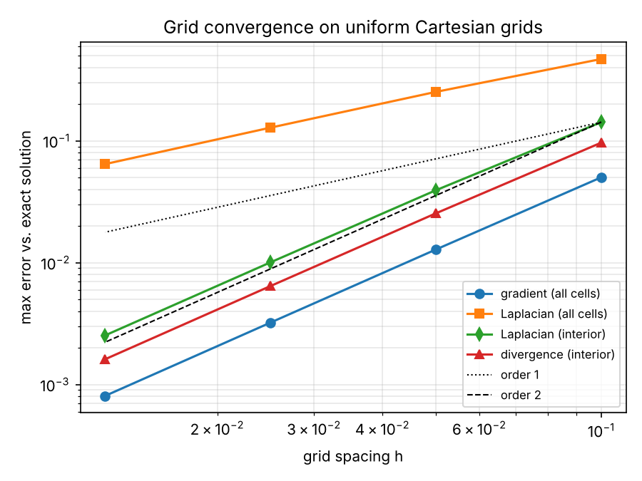

# FVM_structured

[](https://github.com/ishishkina/FVM_structured/actions/workflows/tests.yml)

Finite-volume discretisation of spatial differential operators – **gradient,
divergence, curl (rotor) and Laplacian** – on 2D structured curvilinear grids,
written in Python/NumPy. The operators are verified against exact analytical
solutions by an automated test suite that runs in GitHub Actions and in a
Docker container.

## Features

- Grid metrics for structured curvilinear grids: cell volumes, cell centres, face centres and face vectors
- Gradient: Green–Gauss method with iterative correction for non-orthogonal grids
- Divergence: pure flux form or convective form with central, first-order upwind or second-order upwind schemes
- Curl (z-component) of a 2D vector field
- Laplacian with skewness correction
- Output of all fields and errors in Tecplot format (`.plt`)

## Quick start

Requires Python ≥ 3.10.

```bash
python -m venv .venv
source .venv/bin/activate          # Windows: .venv\Scripts\activate
pip install -r requirements.txt
python A_main.py
```

The run is configured in `input.txt`:

| Key | Meaning |
|---|---|
| `mesh` | mesh file, e.g. `Grids/skew.msh` |
| `data` | optional Tecplot file with velocity and pressure fields; if omitted, analytical test fields from `Functions/B_Functions.py` are used and errors are reported |
| `iterations` | number of Green–Gauss iterations |
| `mod` | divergence scheme: `0` flux form, `1` central, `2` first-order upwind, `3` second-order upwind |

Results are written to `Results/data<N>.plt`. A different input file can be
selected with the environment variable `FVM_INPUT`.

## Tests

```bash
pip install -r requirements-dev.txt
pytest -v
```

The suite checks:

- **Grid metric:** cell volumes sum to the domain area and are positive; outward face vectors of every cell sum to zero.
- **Exactness:** gradient, divergence and curl reproduce linear fields, and the Laplacian reproduces quadratic fields, to round-off on Cartesian grids.
- **Skewed grids:** Green–Gauss iterations recover the exact gradient of a linear field; the skewness-corrected Laplacian of a linear field vanishes in the interior.
- **Grid convergence:** observed order of accuracy on refined grids.
- **Input handling and an end-to-end run** of `A_main.py`.

## Run in Docker

```bash
docker build -t fvm-structured .
docker run --rm fvm-structured                    # run the test suite
docker run --rm fvm-structured python A_main.py   # run the solver
```

## Verification



On uniform Cartesian grids with the smooth field p = sin(πx)·cos(πy), the
gradient converges with second order everywhere. The Laplacian and divergence
converge with second order in the interior and with first order when cells next
to the boundary are included. Reproduce the study with:

```bash
python scripts/convergence_study.py
```

## Known limitations

- Boundary values are imposed through dummy cells located at boundary face
  centres. On strongly skewed grids, the boundary treatment of the Laplacian
  is inaccurate in the first layer of cells; interior cells are not affected.
- Linear face interpolation in the divergence and curl operators has no
  skewness correction, so on skewed grids these operators reproduce linear
  fields only approximately.

## Project structure

```
A_main.py              main script: read input, compute operators, write results
InputTools.py          parsing and validation of input.txt
CalcOperators/         gradient, divergence, curl (rotor), Laplacian
GridTools/             mesh reading, grid metrics, Tecplot output
Functions/             analytical test fields, exact solutions, interpolation
Grids/                 test meshes (Cartesian, skewed, curvilinear)
tests/                 pytest verification suite
scripts/               convergence study
```

## Citation

If you use this code, please cite it using the metadata in
[`CITATION.cff`](CITATION.cff).

## License

MIT – see [LICENSE](LICENSE).
